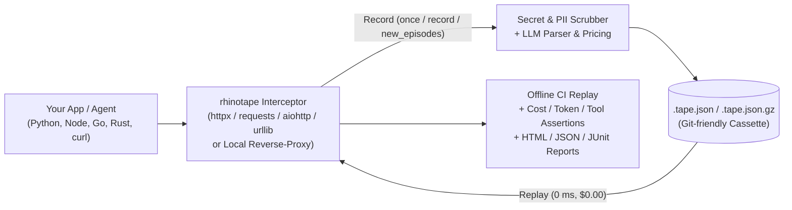

<div align="center">


# rhinotape

**Deterministic record, replay, and assertion toolkit for LLM HTTP & SSE calls — in Python, `pytest`, and any language or framework.**

Zero API spend in CI · Automatic secret & PII scrubbing · True sync & async SSE streaming · Token, USD cost & tool-call assertions · Single core dependency (`httpx`)

[](https://pypi.org/project/rhinotape/)
[](https://github.com/Hoaiduc195/rhinotape/actions/workflows/ci.yml)
[](https://github.com/Hoaiduc195/rhinotape/blob/master/pyproject.toml)
[](https://github.com/Hoaiduc195/rhinotape/blob/master/LICENSE)
[](https://github.com/Hoaiduc195/rhinotape/blob/master/pyproject.toml)
[](https://github.com/astral-sh/ruff)
[-f59e0b.svg)](https://github.com/Hoaiduc195/rhinotape/blob/master/pyproject.toml)

[Quickstart](#quickstart) · [Why rhinotape?](#why-rhinotape) · [Framework Integrations](#framework--polyglot-integrations) · [Providers](#supported-providers) · [CLI](#cli-power-tools) · [Contributing](#contributing)

</div>

---

## Why `rhinotape`?

Testing LLM applications and AI agents against live APIs is slow, flaky, and expensive. Generic HTTP VCR tools were never designed for Server-Sent Events (SSE), prompt-cache billing, tool-calling sequences, or leaking user PII.

| Capability | Live LLM APIs | Generic HTTP VCR | **`rhinotape`** |
| :--- | :---: | :---: | :---: |
| Offline CI at **$0 cost** | No | Yes | **Yes** |
| True sync & async **SSE / NDJSON streaming** | Yes | Partial | **Yes** |
| **Token, USD cost & prompt-cache** assertions | Manual | No | **Built-in** |
| **Tool-call sequence & argument** assertions | Manual | No | **Built-in** |
| Automatic **API key, query-param & PII** scrubbing | N/A | Manual | **Built-in + CLI verifier** |
| **Chaos / fault injection** (429, 503, truncated SSE) | Hard | No | **Built-in (`chaos.py`)** |
| **Any language / framework** (Node, Go, Rust, FastAPI, Flask) | Yes | Python only | **Yes (`rhinotape run` / `serve` / ASGI / WSGI)** |
| Interactive **HTML trace viewer** & PR cost diffs | External SaaS | No | **Zero-CDN local HTML + CLI** |



---

## Installation

```bash
pip install rhinotape
# Optional HTTP adapters (zero extra core bloat):
pip install "rhinotape[requests]"
pip install "rhinotape[aiohttp]"
# Or with uv:
uv add --dev rhinotape
```

`rhinotape` ships with **one** hard runtime dependency (`httpx>=0.27.0`), full PEP 561 `py.typed` strict typing, and works even without `pytest` installed.

---

## Quickstart

### 1. Zero-Code CLI Wrapper (Any Language or Framework)

Wrap **any** test runner or app (`npm test`, `vitest`, `playwright`, `go test`, `cargo test`, `pytest`, `python app.py`) with zero code changes:

```bash
# First run: spin up ephemeral reverse proxy, record live calls, scrub PII, save cassette
rhinotape run tests/tapes/agent.tape.json \
  --mode once \
  --upstream https://api.openai.com \
  --redact-pii -- npm test

# CI run: strict offline replay with cost & unused-interaction gates ($0 spend)
rhinotape run tests/tapes/agent.tape.json \
  --mode replay \
  --max-cost 0.05 \
  --strict-unused -- npm test
```

### 2. Pytest Fixture & CI Budgets

```python
import pytest
from rhinotape import TapeSession


@pytest.mark.tape(
    name="agent_search",
    redact_pii=["email", "ssn"],
    ignore_localhost=True,
    ignore_fields=["metadata.trace_id"],
)
def test_agent_workflow(rhinotape: TapeSession) -> None:
    result = run_my_agent("Find Python 3.13 release notes")

    rhinotape.assert_tool_sequence(["web_search", "summarize"])
    rhinotape.assert_cost_under(0.01)
    rhinotape.assert_tokens_under(2000)
    assert "3.13" in result
```

```bash
# Strict offline CI replay with terminal table, JSON, and interactive HTML trace viewer:
pytest --tape-mode=replay --tape-report \
       --tape-json-report=tape.json \
       --tape-html-report=trace.html \
       --tape-max-cost=0.50 \
       --tape-strict-unused
```

### 3. Context Manager, Decorator & Chaos Testing

```python
import httpx
from rhinotape import MemoryCassetteStore, fail_first, tape, use_tape

store = MemoryCassetteStore(compress=True)

with tape(
    "tests/tapes/weather.tape.json",
    mode="once",
    redact_pii=True,
    max_cost_usd=0.05,
    on_replay=fail_first(1, status_code=429),  # test your retry logic offline
) as session:
    resp = httpx.post(
        "https://api.openai.com/v1/chat/completions",
        headers={"Authorization": "Bearer sk-secret"},
        json={"model": "gpt-4o-mini", "messages": [{"role": "user", "content": "Hi"}]},
    )
    session.assert_call_count(1)
    session.assert_cost_under(0.005)


@use_tape("tests/tapes/async_helper.tape.json", mode="once", store=store)
async def fetch_summary(text: str) -> str:
    ...
```

---

## Framework & Polyglot Integrations

`rhinotape` drops cleanly into **any** stack with zero extra dependencies — see the complete copy-paste cookbook in **[docs/integrations.md](https://github.com/Hoaiduc195/rhinotape/blob/master/docs/integrations.md)** and runnable demos in **[examples/framework_integrations.py](https://github.com/Hoaiduc195/rhinotape/blob/master/examples/framework_integrations.py)**.

| Stack / Framework | Integration Surface |
| :--- | :--- |
| **FastAPI / Starlette / Litestar / Django ASGI** | `TapeASGIMiddleware` (pure ASGI 3.0, `X-Tape-Name` routing, `X-Tape-*` headers) |
| **Flask / Django WSGI / Bottle / Falcon** | `TapeWSGIMiddleware` (pure PEP 3333, streaming-safe lifecycle) |
| **OpenAI / Anthropic / Gemini / LangChain / LlamaIndex / PydanticAI** | Auto-intercepts `httpx` or inject via `make_httpx_client(session)` / `make_async_httpx_client(session)` |
| **stdlib `unittest` & Django `TestCase`** | `TapeTestCaseMixin` (auto `setUp`/`tearDown`, failure-aware `save_on_error`) |
| **Celery / Gradio / Streamlit / CLI Workers** | `TapeConfig.from_env()`, `activate_from_env()`, `current_session()` / `require_session()` |
| **`requests` / `aiohttp` / `urllib` / Custom HTTP clients** | Built-in adapters + `handle_generic_request()` bridge (`curl_cffi`, `niquests`, `boto3`) |
| **Node.js / TypeScript / Go / Rust / Playwright / Vitest / Docker** | `rhinotape run` or `rhinotape serve --mode once --upstream ... --cors` + `/__tape__/*` control plane |

```python
from fastapi import FastAPI
from rhinotape import TapeASGIMiddleware, TapeConfig, require_session

app = FastAPI()
app.add_middleware(TapeASGIMiddleware, config=TapeConfig.from_env(), expose_headers=True)

@app.post("/chat")
async def chat():
    session = require_session()
    ...
    return {"tokens": session.total_tokens, "cost_usd": session.total_cost_usd}
```

---

## Supported Providers

| Provider | Endpoints | JSON | SSE / NDJSON | Tool Calls | Thinking / Reasoning | Cache Billing |
| :--- | :--- | :---: | :---: | :---: | :---: | :---: |
| **OpenAI** (+ Azure, OpenRouter, DeepSeek, Groq, Together, Fireworks, Mistral/FIM, xAI Grok, Perplexity, Hugging Face) | Chat Completions, Responses API, Embeddings, Audio, Images | Yes | Yes | Yes | Yes | Yes |
| **Anthropic** | Messages API | Yes | Yes | Yes | Yes | Yes (incl. 1.25x write) |
| **Google Gemini / Vertex AI** | `:generateContent`, `:streamGenerateContent` | Yes | Yes | Yes | Yes | Yes |
| **Cohere** | `/v2/chat`, `/v1/chat` | Yes | Yes | Yes | — | — |
| **Ollama** | `/api/chat`, `/api/generate` | Yes | Yes | Yes | Yes | — |
| **AWS Bedrock** | Converse API | Yes | — | Yes | — | Yes |

Custom & private model pricing is supported via `custom_pricing={...}` or `RHINOTAPE_PRICING_FILE=pricing.json`.

---

## Key Capabilities

- **Record & Replay Modes:** `once`, `replay`, `record`, `new_episodes`, `none` — with deterministic gzip `.tape.json.gz`, atomic writes, `MAX_CASSETTE_BYTES` zip-bomb guards, and pluggable `CassetteStore` (`FileCassetteStore`, `MemoryCassetteStore`).
- **Automatic Secret & PII Scrubbing:** Redacts API keys, cookies, URL userinfo, sensitive/presigned query params, wildcard headers (`x-secret-*`), URL path patterns, dot-path JSON fields, regex patterns, and built-in PII presets (`email`, `phone`, `ssn`, `credit_card`, `ipv4`, `jwt`).
- **Composable Matchers & Semantic Diffs:** Presets (`MATCH_STRICT`, `MATCH_RELAXED`, `MATCH_PATH_AND_BODY`), `ignore_fields`, `ignore_query_params`, `ignore_json_array_order`, `match_headers`, combinators (`match_all`, `match_any`, `match_json_subset`, `match_json_regex`, `match_header_equals`, `match_fuzzy_text`), and semantic JSON key-path diffs on mismatch.
- **25+ Built-in Assertions:** `assert_cost_under`, `assert_max_cost_per_call`, `assert_tokens_under`, `assert_max_tokens_per_call`, `assert_reasoning_tokens_under`, `assert_cached_tokens_at_least`, `assert_cache_hit_rate_at_least`, `assert_json_output`, `assert_text_contains`, `assert_text_matches`, `assert_thinking_present`, `assert_streamed`, `assert_not_streamed`, `assert_status_codes`, `assert_model`, `assert_provider`, `assert_tool_called`, `assert_no_tool_called`, `assert_tool_call_count`, `assert_tool_args`, `assert_tool_sequence`, `assert_call_count`, `assert_no_errors`, `assert_no_unused_interactions`, `assert_max_latency_ms`.
- **Chaos & Circuit Breakers:** `fail_nth`, `fail_first`, `inject_latency`, `corrupt_json_body`, `truncate_stream`, `chain_replay_hooks`, `replace_response`, plus concurrency-safe `max_interactions` and `max_cost_usd` live recording guardrails.

---

## CLI Power Tools

Available via `rhinotape` or `python -m rhinotape`:

```bash
# Inspect, analyze & search cassettes
rhinotape inspect tests/tapes/agent.tape.json --show-bodies --show-thinking
rhinotape summary tests/tapes --group-by dir --max-cost 0.50
rhinotape stats tests/tapes
rhinotape list tests/tapes --sort cost --limit 10
rhinotape search tests/tapes --tool web_search --status 200 --min-cost 0.001
rhinotape pricing --filter claude

# CI verification, secret & PII gates, fingerprint checks & regression diffs
rhinotape verify tests/tapes --check-secrets --check-pii
rhinotape replay-check tests/tapes --ignore-fields metadata.trace_id
rhinotape diff baseline/ candidate/ --max-cost-increase-pct 15 --fail-on-tool-change --show-text-diff --markdown

# Maintenance: redact, reparse pricing, merge/split, gzip convert, prune stale
rhinotape redact tests/tapes --pii email,ssn --url-pattern '/tenants/[^/]+' --dry-run
rhinotape reparse tests/tapes
rhinotape merge a.tape.json b.tape.json -o combined.tape.json --deduplicate
rhinotape split combined.tape.json -o split_dir/
rhinotape convert tests/tapes --to gzip --delete-source
rhinotape prune tests/tapes --tests-dir tests/ --older-than-days 30

# Export reports (Markdown, CSV, HAR 1.2, interactive HTML, JUnit XML), serve & run
rhinotape export tests/tapes --format html -o trace.html
rhinotape export tests/tapes --format junit -o junit.xml
rhinotape serve tests/tapes/agent.tape.json --mode once --upstream https://api.openai.com --cors --redact-pii
rhinotape run tests/tapes/agent.tape.json --mode replay --max-cost 0.05 -- npm test
```

### Pre-Commit Hook

Block accidental API key or PII leaks in committed cassettes automatically:

```yaml
repos:
  - repo: https://github.com/Hoaiduc195/rhinotape
    rev: v0.4.0
    hooks:
      - id: rhinotape-verify-pii
```

---

## Contributing

Contributions are warmly welcome! Whether you want to add a new LLM provider parser, improve CLI/reporting UX, add framework cookbooks, or tackle a bug:

1. Browse open [**good first issues**](https://github.com/Hoaiduc195/rhinotape/issues?q=is%3Aissue+is%3Aopen+label%3A%22good+first+issue%22) or [**help wanted**](https://github.com/Hoaiduc195/rhinotape/issues?q=is%3Aissue+is%3Aopen+label%3A%22help+wanted%22) tasks.
2. Read **[CONTRIBUTING.md](https://github.com/Hoaiduc195/rhinotape/blob/master/CONTRIBUTING.md)** for the codebase map, design principles, and PR checklist.
3. Run the full offline check suite locally:

```bash
uv sync --extra dev
uv run ruff check src tests examples
uv run ruff format --check src tests examples
uv run mypy
uv run pytest -v -W error
```

---

## Security & License

- **Security Policy:** See [SECURITY.md](https://github.com/Hoaiduc195/rhinotape/blob/master/SECURITY.md) for responsible disclosure and built-in scrubbing/decompression guarantees.
- **Changelog:** See [CHANGELOG.md](https://github.com/Hoaiduc195/rhinotape/blob/master/CHANGELOG.md).
- **License:** Released under the [MIT License](https://github.com/Hoaiduc195/rhinotape/blob/master/LICENSE).
